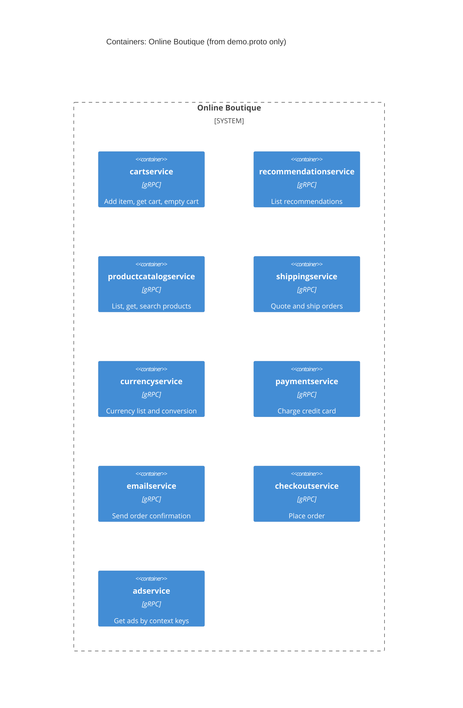

# Run A: Recovered architecture (evidence: `demo.proto` only)

## 1. Agent

Claude Code, model Claude Sonnet 5.5 (`claude-sonnet-5-5`).

## 2. Files read

- `prompts/1-recover-architecture.md` (task file)
- `AGENTS.md` (rules)
- `system/online-boutique/protos/demo.proto` (the only evidence file)

## 3. Containers table

Each service is a gRPC `service` declaration in the proto file. The proto file shows no language, runtime or deployment unit, so "technology" is limited to what is evidenced.

| Container | Technology / language | Responsibility | Evidence |
|---|---|---|---|
| `cartservice` | gRPC service (language not evidenced) | Add item to cart, get cart, empty cart, per user | `demo.proto` L23-27 (`service CartService`: `AddItem`, `GetCart`, `EmptyCart`) |
| `recommendationservice` | gRPC service (language not evidenced) | List recommended product ids for a user, given product ids | `demo.proto` L56-58 (`RecommendationService.ListRecommendations`) |
| `productcatalogservice` | gRPC service (language not evidenced) | List, get and search products | `demo.proto` L71-75 (`ProductCatalogService`: `ListProducts`, `GetProduct`, `SearchProducts`) |
| `shippingservice` | gRPC service (language not evidenced) | Quote shipping cost, ship an order and return a tracking id | `demo.proto` L107-110 (`ShippingService`: `GetQuote`, `ShipOrder`) |
| `currencyservice` | gRPC service (language not evidenced) | List supported currencies, convert `Money` between currencies | `demo.proto` L140-143 (`CurrencyService`: `GetSupportedCurrencies`, `Convert`) |
| `paymentservice` | gRPC service (language not evidenced) | Charge a credit card, return a transaction id | `demo.proto` L177-179 (`PaymentService.Charge`) |
| `emailservice` | gRPC service (language not evidenced) | Send an order confirmation email | `demo.proto` L199-201 (`EmailService.SendOrderConfirmation`) |
| `checkoutservice` | gRPC service (language not evidenced) | Place an order (`PlaceOrder`) | `demo.proto` L224-226 (`CheckoutService.PlaceOrder`) |
| `adservice` | gRPC service (language not evidenced) | Return ads for given context keywords | `demo.proto` L243-245 (`AdService.GetAds`) |

No data store, message broker, web frontend or external system is declared in the proto file. The proto file lists 9 services.

## 4. Dependencies table

The proto file declares what each service **offers**, not who **calls** it. No caller → callee dependency is directly evidenced, so this table is empty on purpose.

| Caller → Callee | Protocol | Evidence |
|---|---|---|
| None evidenced in the provided files | n/a | `demo.proto` contains only service and message definitions; there are no client stubs, addresses or call sites |

Hints that are **not** dependencies (listed under Gaps): `PlaceOrderRequest` carries `credit_card`, `address` and `email`, and `OrderResult` is reused by `SendOrderConfirmationRequest`.

## 5. Mermaid diagram

The diagram matches the two tables: nine containers, no `Rel` (none evidenced), and no `Person` (no user-facing entry point is evidenced).

## 6. Gaps

| Gap | Why it is not in the diagram | Extra file that would settle it |
|---|---|---|
| Who calls each service | A proto file defines servers, not clients | Kubernetes manifests (`*_ADDR` environment variables) or each service's source |
| `checkoutservice` probably orchestrates cart, product catalog, currency, shipping, payment and email **[Inferred]** | Its `PlaceOrderRequest` has `user_id`, `user_currency`, `address`, `email` and `credit_card`, and `OrderResult` is reused by `EmailService`. This suggests that, but nothing proves who calls whom | `kubernetes-manifests/checkoutservice.yaml` or `src/checkoutservice/main.go` |
| A web frontend / end user | No service in the proto file is user-facing, and no HTTP is described | Manifests (`frontend.yaml`) |
| Data stores (e.g. where the cart is kept) | `CartService` has no storage information | Manifests or `src/cartservice` |
| Any external system (payment provider, mail server) | Not mentioned | Service source or manifests |
| Language and runtime of each service | The proto file has only a Go package option (`go_package`), which may not describe the services | Dockerfiles or `src/*` |
| Whether all nine services are deployed | A proto file doesn't say what is deployed | Manifests |
