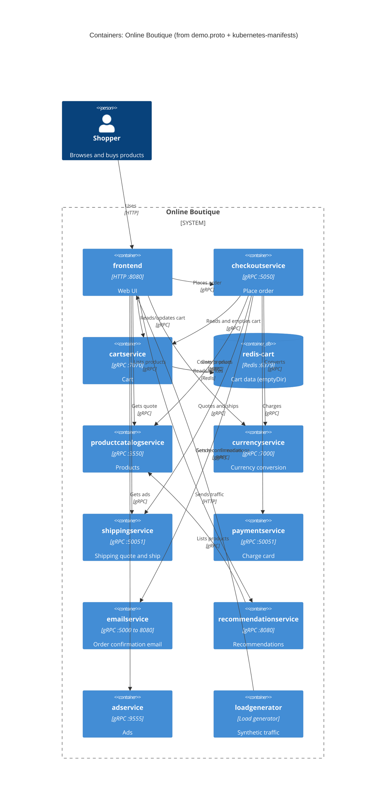

# Run B: Recovered architecture (evidence: `demo.proto` + `kubernetes-manifests/`)

## 1. Agent

Claude Code, model Claude Sonnet 5.5 (`claude-sonnet-5-5`).

## 2. Files read

- `prompts/1-recover-architecture.md` (task file)
- `AGENTS.md` (rules)
- `system/online-boutique/protos/demo.proto`
- `system/online-boutique/kubernetes-manifests/`: `README.md`, `kustomization.yaml`, `frontend.yaml`, `checkoutservice.yaml`, `cartservice.yaml`, `recommendationservice.yaml`, `loadgenerator.yaml`, `adservice.yaml`, `currencyservice.yaml`, `emailservice.yaml`, `paymentservice.yaml`, `productcatalogservice.yaml`, `shippingservice.yaml` (the last six were read only for names, images, ports and env vars)

## 3. Containers table

All paths below are under `system/online-boutique/kubernetes-manifests/` unless stated. Implementation languages are not evidenced by these files (the manifests only name an `image:`).

| Container | Technology / language | Responsibility | Evidence |
|---|---|---|---|
| `frontend` | HTTP server on 8080 (language not evidenced) | Web UI for the shopper; calls the backend services | `frontend.yaml` (`containerPort: 8080`, httpGet `/_healthz`, `Service frontend-external` type `LoadBalancer`) |
| `checkoutservice` | gRPC, port 5050 | Place an order; orchestrates cart, catalog, currency, shipping, payment, email | `checkoutservice.yaml` (`PORT=5050`, grpc probe); `demo.proto` L224-226 |
| `cartservice` | gRPC, port 7070 | Cart per user | `cartservice.yaml` (`containerPort: 7070`); `demo.proto` L23-27 |
| `redis-cart` | Redis (`image: redis:alpine`), port 6379 | Cart data store; storage is `emptyDir`, so data is lost when the pod is rescheduled | `cartservice.yaml` (Deployment `redis-cart`, `volumes: emptyDir: {}`) |
| `productcatalogservice` | gRPC, port 3550 | List, get and search products | `productcatalogservice.yaml` (`PORT=3550`); `demo.proto` L71-75 |
| `currencyservice` | gRPC, port 7000 | Currency list and conversion | `currencyservice.yaml` (`PORT=7000`); `demo.proto` L140-143 |
| `shippingservice` | gRPC, port 50051 | Shipping quote and ship order | `shippingservice.yaml` (`PORT=50051`); `demo.proto` L107-110 |
| `paymentservice` | gRPC, port 50051 | Charge credit card | `paymentservice.yaml` (`PORT=50051`); `demo.proto` L177-179 |
| `emailservice` | gRPC; pod listens on 8080, Service exposes 5000 | Send order confirmation email | `emailservice.yaml` (`containerPort: 8080`, Service `port: 5000`, `targetPort: 8080`); `demo.proto` L199-201 |
| `recommendationservice` | gRPC, port 8080 | Recommend products | `recommendationservice.yaml` (`PORT=8080`); `demo.proto` L56-58 |
| `adservice` | gRPC, port 9555 | Return ads | `adservice.yaml` (`PORT=9555`); `demo.proto` L243-245 |
| `loadgenerator` | Load generator (image `loadgenerator`) | Generates synthetic traffic against the frontend | `loadgenerator.yaml` (`FRONTEND_ADDR=frontend:80`, `USERS=10`, `RATE=1`). It is not listed in `kustomization.yaml`, so it may be a test tool and not part of the product |

## 4. Dependencies table

| Caller → Callee | Protocol | Evidence |
|---|---|---|
| Shopper → `frontend` | HTTP | `frontend.yaml` (`Service frontend-external`, `type: LoadBalancer`, port 80 → 8080) |
| `loadgenerator` → `frontend` | HTTP | `loadgenerator.yaml` (`FRONTEND_ADDR=frontend:80`) |
| `frontend` → `productcatalogservice` | gRPC | `frontend.yaml` (`PRODUCT_CATALOG_SERVICE_ADDR=productcatalogservice:3550`) |
| `frontend` → `currencyservice` | gRPC | `frontend.yaml` (`CURRENCY_SERVICE_ADDR=currencyservice:7000`) |
| `frontend` → `cartservice` | gRPC | `frontend.yaml` (`CART_SERVICE_ADDR=cartservice:7070`) |
| `frontend` → `recommendationservice` | gRPC | `frontend.yaml` (`RECOMMENDATION_SERVICE_ADDR=recommendationservice:8080`) |
| `frontend` → `shippingservice` | gRPC | `frontend.yaml` (`SHIPPING_SERVICE_ADDR=shippingservice:50051`) |
| `frontend` → `checkoutservice` | gRPC | `frontend.yaml` (`CHECKOUT_SERVICE_ADDR=checkoutservice:5050`) |
| `frontend` → `adservice` | gRPC | `frontend.yaml` (`AD_SERVICE_ADDR=adservice:9555`) |
| `checkoutservice` → `productcatalogservice` | gRPC | `checkoutservice.yaml` (`PRODUCT_CATALOG_SERVICE_ADDR=productcatalogservice:3550`) |
| `checkoutservice` → `shippingservice` | gRPC | `checkoutservice.yaml` (`SHIPPING_SERVICE_ADDR=shippingservice:50051`) |
| `checkoutservice` → `paymentservice` | gRPC | `checkoutservice.yaml` (`PAYMENT_SERVICE_ADDR=paymentservice:50051`) |
| `checkoutservice` → `emailservice` | gRPC | `checkoutservice.yaml` (`EMAIL_SERVICE_ADDR=emailservice:5000`) |
| `checkoutservice` → `currencyservice` | gRPC | `checkoutservice.yaml` (`CURRENCY_SERVICE_ADDR=currencyservice:7000`) |
| `checkoutservice` → `cartservice` | gRPC | `checkoutservice.yaml` (`CART_SERVICE_ADDR=cartservice:7070`) |
| `cartservice` → `redis-cart` | Redis protocol (TCP) | `cartservice.yaml` (`REDIS_ADDR=redis-cart:6379`) |
| `recommendationservice` → `productcatalogservice` | gRPC | `recommendationservice.yaml` (`PRODUCT_CATALOG_SERVICE_ADDR=productcatalogservice:3550`) |

The protocol "gRPC" is inferred from the grpc probes, the `grpc` port names, and the service definitions in `demo.proto`; the `*_ADDR` variables alone only give host:port.

## 5. Mermaid diagram

## 6. Gaps

| Gap | Why it is not in the diagram | Extra file that would settle it |
|---|---|---|
| `frontend` has `SHOPPING_ASSISTANT_SERVICE_ADDR=shoppingassistantservice:80`, but no `shoppingassistantservice` manifest, proto service or kustomize entry exists in the evidence | I can't show a container or dependency that the files don't define. It might be an optional component deployed elsewhere **[Inferred]** | `src/frontend/` source, `/release` manifests |
| Whether `frontend` really calls every service in its env list | Env vars show that an address is configured, not that it is used | `src/frontend/*.go` |
| Whether `checkoutservice` calls all six services in its env list | Same reason | `src/checkoutservice/main.go` |
| The `loadgenerator` is not in `kustomization.yaml` | Included in the diagram because its manifest is present; whether it is part of the architecture is not clear | `kustomization.yaml` lists no `loadgenerator`; deployment docs |
| Implementation language of each service | Manifests only have `image: <name>` | Dockerfiles, `src/*` |
| Any external system (real payment provider, mail server) | No external address in the evidence | `src/paymentservice`, `src/emailservice` |
| Emails: `emailservice` Service port 5000 maps to pod port 8080 | Evidenced, but the reason is not | `src/emailservice` |
| Whether `adservice` or `recommendationservice` have other dependencies | None shown in env vars | Their source |
| Manifests are "not directly deployable" (`README.md`: need `skaffold` to insert image tags; use `/release` instead) | The deployed system may differ from these files | `/release` directory |
